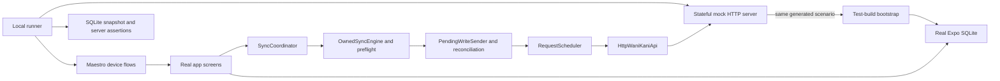

# Local mutation E2E harness for Taatoru

Date: 25 October 2026; implementation refresh: 1 November 2026. Status: user authorized plan refresh and implementation.

Sync integration revision: rechecked against `f8fe7d0` on 1 November 2026. Implementation steps are in `../plans/2026-11-01-local-mutation-e2e.md`.

## Intent and agreed approach

Build a lightweight local WaniKani mock and Android E2E harness for realistic study sessions, level progression and content gating, without a real account or WaniKani learning content. Exercise the main mutation paths through real screens, SQLite, pending writes, and `HttpWaniKaniApi`. Treat up to 200 available lessons and 1,000 due reviews as extreme UI coverage, not the regular workload or the central purpose of the harness.

The user selected **a local HTTP server plus a seeded Android test build**, then clarified that level/current-level gating and strictly non-WaniKani fake content belong in scope. Authentication and synchronization correctness are outside this first project. Read endpoints expose mutations and progression through the existing refresh lifecycle; they are infrastructure, not a new sync test suite.

Other approaches considered:

| Approach | Benefit | Cost / limitation |
| --- | --- | --- |
| Local HTTP + seeded build, selected | Real serialization and transport; useful for manual exploration and automated device tests | Requires a small bootstrap seam and server state |
| In-app `WaniKaniApi` fake | Least server infrastructure | Misses HTTP requests and is less useful outside app tests |
| Fuller WaniKani simulator | Could eventually test onboarding and synchronization | Excess scope: authentication, complete sync semantics and exact scheduling; a bounded progression/dependency model is included in the selected approach |

## Existing seams and constraints

- `src/api/HttpWaniKaniApi.ts` already accepts `baseUrl`, `fetch`, and `now`; preserve its production default.
- `src/app/AppProviders.tsx` now composes `SyncCoordinator` → `OwnedSyncEngine` → `SyncPreflight`/`SynchronizationEngine` → `PendingWriteSender`/`WriteReconciler`, with `RequestScheduler` wrapping HTTP. Authentication validation uses a credential reservation; runtime/background requests use a sync lease. Preserve these contexts, scheduler callbacks and abort signals when supplying the local API origin.
- `SessionRepository.commitLessonTransition()` and `ReviewSessionRepository.commitReviewTransition()` atomically save session state and enqueue progress via `PendingWriteRepository`.
- `PendingWriteSender` requires typed authoritative receipts. HTTP 422 triggers reconciliation; it no longer means discard. Unresolved work stays visible for attention. Network/server failures can leave durable uncertain dispatches, which must be reconciled before replay.
- `SecureTokenStore(db)` resolves versioned credential slots via `sync_control`. `AuthManager.resume()` also needs an active account context for uploads. A cached user plus `last_sync_at` and a legacy token alone no longer constitute a valid seeded setup.
- Quick sync preflights user identity and reset history before mutation delivery, performs targeted reconciliation reads, then refreshes resource collections. A write-only mock or generic empty lookup responses would fail or cause false reconciliation.
- Lesson/review/material routes call `AppServices.notifyPendingWrites()` after durable commits. The foreground coordinator automatically drains on enqueue/startup/foreground/reconnect and exposes queue/delivery state through `syncStore`; manual refresh is not the primary upload trigger.
- Pending rows carry operation keys, revisions, account epochs, immutable source snapshots and fixed wire timestamps; `sync_dispatches` preserves dispatched evidence. Pending-state overlays protect local completion/edits during refresh. Seed queued work through current repository APIs, not old hand-written pending-row SQL.
- Current scheduling spaces requests by 1,100 ms, persists quota/backoff, and applies a 30-second request deadline. Refresh batches select up to four progress operations and eight total operations, with subsequent drains owned by the coordinator. Do not infer capacity from the old `selectPendingWrites` budget helper, which is no longer the runtime path.
- `ExpoDatabase.open(name)` and `NodeTestDatabase.open(filename)` already allow separate databases. Existing resource repositories populate the derived data and search index through normal code paths.
- The current app has Jest, React Native Testing Library, `better-sqlite3`, and Node 22, but no device E2E runner.
- The current-level dashboard joins subjects to assignments; missing/locked assignments are distinct from unlocked lessons. Available-item queries enforce subscription level and trust server assignment unlock state. Model user level, subscription cap and prerequisites separately, rather than relying on the app to reconstruct missing server gates.
- Existing `src/test/sync/` fixtures and `scripts/sync-native/` exercise native SQLite, ownership, lost-response recovery and study UI using an in-process API. Reuse their setup/runner patterns where helpful, retain that regression coverage, and add the real HTTP/production-route layer here. Do not import their learning-content fixtures into the original-content factory.
- Database and synchronization/authentication work appeared in the checkout during investigation. Treat those interfaces as moving input: use their current entry points and repositories, and do not add an E2E-specific schema migration or modify that unrelated work.

## Proposed components



### 1. Synthetic content factory and scenario generator

Separate a pure TypeScript content factory from the scenario/account-state builder. The factory creates a deterministic catalog of levels, subjects and prerequisite edges. The scenario builder places a synthetic account within that catalog and derives its lessons, reviews and current-level progress. Both server and bootstrap consume the same generated scenario.

Factory inputs: seed, level count (up to 60), per-level type counts, and dependency shape. Scenario inputs: catalog, current level, subscription cap, prerequisite-pass/SRS state, reference timestamp and a workload preset. Outputs: API-shaped typed resources, a runner-only answer manifest, and explicit expected availability/progression sets. Requested workload counts must produce a valid reachable account state or fail with a useful error; never unlock higher-level subjects simply to satisfy a number.

Use `src/api/types.ts` for wire shapes only. Do not clone or import learning content from `src/fixtures/api.ts`, real API responses, Tsurukame, Smouldering Durtles, or WaniKani pages. Procedurally create original labels, accepted meanings, kana readings, mnemonics and example text. Use geometric radical characters and generated display strings/kana combinations suitable for each subject type. These are visibly synthetic test items, not a Japanese teaching corpus. Individual Unicode characters may naturally overlap; supplied learning entries and authored explanations must not be copied. Include a few independently authored distinctive examples for manual readability, while bulk catalog generation remains deterministic.

Generate unique subject, assignment, and study-material IDs, valid type-specific fields, stable lesson positions, and consistent forward/reverse component links. Include radical, kanji, vocabulary and kana vocabulary. Validate acyclic dependencies, allowed dependency types, existing component IDs and prerequisites at the same or an earlier level. Generate meanings/readings that the real answer checker accepts; radicals and kana vocabulary have no reading question. Test repeatability, different-seed variation and manifest correctness through the real answer checker without generating expected progression by invoking the mock engine itself.

Initial presets, proposed values:

| Preset | Lessons | Due reviews | Future reviews | Purpose |
| --- | ---: | ---: | ---: | --- |
| smoke | 8 | 12 | 8 | Short complete lesson/review flows across all types |
| daily | 20 | 80 | 40 | Default illustrative everyday workload |
| backlog | 80 | 300 | 100 | Heavier illustrative backlog across unlocked levels |
| extreme | 200 | 1,000 | 200 | Explicit upper-end UI/count/resume coverage |

The user supplied the extreme sizes; daily/backlog values are proposed test defaults, not measured usage statistics. Also provide first-level, mid-level, prerequisite-unlock, one-review-before-level-up, subscription-cap, final-level, empty-state and study-material scenarios. Counts describe available items, not catalog size. Previously unlocked vocabulary can remain as a lesson backlog from earlier levels. The scalable catalog may contain thousands of subjects while available queues remain within the intended workload.

Hidden, locked, future and above-subscription subjects must have explicit expected exclusion sets. Include future-level subjects in the catalog/search where the app normally supports them, without leaking them into lesson/review availability.

Do not fetch real content, audio or images. Default generated pronunciation audio/image lists to empty and disable autoplay via seeded preferences. Mutation E2E does not claim media coverage.

### 2. Small stateful HTTP server

Use Node's built-in HTTP server, TypeScript and existing test tooling. Prefer no runtime server framework, container, database service or separate package. Retain state in memory and write optional JSON artifacts under an ignored output directory.

Implement the app's actual request shapes:

| Method / route | Contract |
| --- | --- |
| `PUT /v2/assignments/:id/start` | Validate known, unstarted assignment and `started_at`; update state and return the full updated assignment resource |
| `POST /v2/reviews` | Validate identity, counts and completion timestamp; advance assignment and statistics atomically; return a review envelope with `object: 'review'` and `resources_updated.assignment` plus `resources_updated.review_statistic` |
| `POST /v2/study_materials` | Create material for an existing subject; return the full material resource with stable positive ID |
| `PUT /v2/study_materials/:id` | Update notes/synonyms; preserve null/empty-array semantics; return the full updated material resource |
| `GET /v2/assignments/:id` | Return the exact assignment opportunity used by progress reconciliation, including unlock/start/availability/resurrection/burn fields; unknown IDs return 404 |
| `GET /v2/resets` | Valid empty collection by default, including `updated_after` support; no reset simulation required for core suites |
| `GET /v2/study_materials?subject_ids=:id` | Return only that subject's material or an authoritative empty collection; never disguise lookup failure as absence |
| `GET /v2/review_statistics?subject_ids=:id` | Return only that subject's current statistics or an authoritative empty collection |
| `GET /v2/user` | Return the synthetic cached account |
| `GET /v2/{subjects,assignments,study_materials,level_progressions,voice_actors,review_statistics}` | Return valid resource collections sufficient for existing quick-sync calls |

Read responses must reflect accepted writes. In particular, refreshing must not restore a just-completed lesson/review as available. Run the bounded progression model below after each accepted mutation, update affected resources and expose newly unlocked assignments through ordinary GETs. Do not reuse the app's SRS projection as the test oracle.

Support the client's current `subject_ids`, `updated_after`, `hidden`, `unlocked`, and page/cursor requests sufficiently to return coherent collections, including replayed/overlapping timestamp windows. Honor subject filtering exactly: the client rejects unrelated/multiple lookup results. Generate pagination URLs using the local origin only. Resource update watermarks must be monotonic, including two writes in the same millisecond, without inventing future HTTP `Date` values that distort the scheduler's clock-skew estimate. Keep HTTP `Date`, quota reset and `Retry-After` headers coherent with real time. Full pagination/sync fidelity tests are deferred.

Separate a host-side control API from `/v2`: reset scenario, inspect state, inspect request journal, and arm one-shot failure rules by method/path/occurrence. Keep attempted requests, accepted mutations, response status, sequence and affected IDs separately. Unknown routes and malformed mutations fail visibly; never return generic success for everything.

Initial faults: fail before acceptance with HTTP 500/drop; accept a write atomically and then drop or malform its response; hold/release a matching response; and return 422 without acceptance. Allow a bounded 429/`Retry-After` case to exercise normal pacing. Journal acceptance separately from delivery and arm faults before the triggering UI action, since uploads now start automatically.

Accepted-review evidence must advance review counters and change the assignment cycle (future due time or burned state), with the same IDs returned by both receipts and targeted GETs. An accepted lesson has a non-null `started_at`. Preserve those facts after dropping the response. A changed due time alone must not masquerade as proof of review acceptance. Material POST must publish its positive ID immediately even if the response is lost, allowing lookup recovery without a second create. Retrying a rejected duplicate must not silently apply another progress transition; return the current authoritative state through lookups. Do not add a fake idempotency-key protocol absent from the real API or claim general exactly-once guarantees.

Return valid JSON errors and correctly shaped success receipts decoded by the current client. Keep normal `RequestScheduler` pacing/deadlines, lease checks and coordinator batching in native E2E. Raising mock quota does not bypass 1,100 ms request spacing. Use bounded UI workloads and realistic wait budgets, and test large catalogs without trying to drain all reviews. Faster pure server/reconciliation tests may use existing clock/sleep injection seams; label them as integration tests rather than native pacing coverage. Do not add a production scheduler-speed switch to accelerate this harness.

### Sync integration contract

Keep the full production ownership/delivery chain. HTTP integration tests must assert receipts pass through `HttpWaniKaniApi`, settle the correct operation/revision and leave pending overlays intact until acknowledged, superseded by evidence, or explicitly resolved. Account epochs, operation keys and owner fences are local metadata, not invented remote request headers.

Use the coordinator/store and bounded polling to distinguish transport completion from delivery: `status: 'completed'` does not establish an empty queue. Observe `queue.pending`, `queue.uncertain`, `queue.rejected`, `queue.nextAttemptAt` and `delivery: complete | pending | attention`; inspect pending rows, dispatch evidence and saved-change history in SQLite snapshots. Some preserved material history can contribute to the queue summary after a current pending row has settled. Successful delivery requires the intended revisions to be settled, not merely a green refresh indicator or `COUNT(pending_progress) = 0`.

For core failure/recovery tests, assert accepted-write/lost-response recovery does not submit another review or material create. Classify review settlement by authoritative evidence as acknowledged versus superseded; superseded means the remote opportunity advanced, not proof that this client delivered it. Remote review advancement without this client's dispatched evidence now requires review-conflict attention. A 422 with no evidence of acceptance remains available for attention; never expect silent deletion. Expose enough server controls to hold an older material response while the UI saves a newer edit, then verify the newer revision survives settlement where current ownership/revision guards permit it. Conflicting remote notes/synonyms are now authoritative; test that current policy rather than the earlier proposed conflict-merge UI.

Disable OS-scheduled background entry points for deterministic core runs, but retain foreground enqueue, lifecycle/reconnect signals, data invalidation subscriptions and retry timers. Do not route the E2E app directly to `SynchronizationEngine` or call `PendingWriteSender` to bypass ownership/pacing. Existing native sync fixtures remain responsible for broader lease/account/reset stress tests; this project needs only setup validity and the user mutation/recovery outcomes they enable.

### 3. Bounded level and prerequisite progression

This is authoritative mock-server behavior, not new level logic in Taatoru. The content catalog defines the synthetic curriculum; account state tracks `user.level`, `subscription.max_level_granted`, assignments, first-pass timestamps, review statistics and level-progression resources independently.

- **Level eligibility:** a new lesson must be at or below both the account's current level and subscription cap. Earlier-level backlogs and reviews remain valid after a level-up. Reaching a level does not automatically unlock every subject within it.
- **Prerequisites:** radicals and dependency-free kana vocabulary unlock on reaching their eligible level; kanji require all their radical prerequisites to have passed; vocabulary requires all its kanji prerequisites to have passed. Dependency-free items unlock when level-eligible. Keep locked assignments locked (or omit them from `unlocked=true` responses) while keeping their subject definitions in the catalog.
- **Lesson completion:** only accepting an assignment-start mutation moves that assignment from unlocked/unstarted stage 0 to stage 1 with a future review time. Merely selecting, presenting or cancelling does not unlock anything.
- **Review completion:** correct reviews advance one SRS stage; crossing stage 4 to 5 first sets `passed_at`. Incorrect reviews must not accidentally trigger a pass or level-up; implement a small documented mistake penalty independent of the app projection. Exact WaniKani penalty parity and real elapsed intervals remain outside scope. Clamp valid stages, preserve first-pass history after later mistakes, and represent burned items without another due review.
- **Unlock propagation:** after first passing a prerequisite, evaluate dependents against first-pass history and level eligibility. Once unlocked, an item stays unlocked if its prerequisite later drops below Guru. Reject starts/reviews for locked, unknown, not-due or otherwise ineligible assignments without progressing them.
- **Level-up:** require `ceil(0.9 * eligibleKanjiCount)` distinct first-passed kanji in the current level, excluding hidden catalog items. Pin a 10-kanji case at 8 passed (no advance) and 9 passed (advance), plus an 11-kanji rounding case requiring 10. Radicals and vocabulary do not count. A playable level must contain kanji, so an empty denominator never auto-passes a level.
- **Transition bookkeeping:** stamp the outgoing level's `passed_at`, create/unlock the next level progression, update `user.level`, and unlock only newly eligible subjects whose prerequisites are satisfied. Reevaluate same-level vocabulary and new-level candidates in a deterministic transaction. Stop at the configured catalog end, level 60, or subscription cap; at a cap retain the account level and do not invent inaccessible next-level assignments. Keep earlier unfinished lessons/reviews intact.
- **Time control:** seed transition cases immediately before the relevant review (for example, a due stage-4 prerequisite). A host-only `make-due` control can bring selected started assignments forward to a captured wall-clock time, followed by ordinary app refresh. Invoke it only after prior work for those assignments is fully settled and the coordinator is idle; changing the opportunity under pending work would correctly cause reconciliation attention. This allows repeated review cycles without hours of waiting or global app-clock changes. Journal this explicit test shortcut; never count it as a user mutation or modify app SQLite directly to unlock content.

Acceptance compares explicit hand-authored transition expectations against the mock's output, then verifies the app consumes those resources through its existing refresh. Cover prerequisite combinations, first-pass history after demotion, 90% threshold rounding, current-level/subscription gates, final-level behavior and idempotent level bookkeeping after rejected duplicate writes. Assert dashboard level/progress, lesson IDs, server state and persisted local rows. This tests mutation consequences; it does not certify the entire synchronization engine.

Behavioral references for the modeled subset: [WaniKani lesson unlocking](https://knowledge.wanikani.com/getting-started/unlock-new-lessons/), [level thresholds and permanent pass history](https://knowledge.wanikani.com/widgets/level-progress/), and [Guru at stage 5](https://knowledge.wanikani.com/wanikani/srs-stages/). Copy no learning content from these sources. Synthetic curriculum sizes and simplified scheduling are harness decisions.

### 4. Isolated E2E build and bootstrap

Use a dedicated local Android development build with package `app.taatoru.e2e`, distinct app name/scheme and database `taatoru-e2e.db`. Keep it debuggable for host-side SQLite inspection. Initial delivery may use Metro; the runner owns startup, opens the correct development URL and waits for app readiness before running flows. A bundled standalone test APK is a later convenience, not a prerequisite.

Select E2E mode through explicit build configuration. Production builds keep the normal package, default API origin and bootstrap. Verify release configuration cannot enable E2E bootstrap or arbitrary API overrides. Permit local cleartext networking only in the test variant. No normal-app settings switch or general-purpose reset route is needed.

Before mounting authentication/routes, fetch the active scenario from the local server and migrate the dedicated database. Establish a versioned fake credential through `SyncControlRepository.beginCredentialTransition()`, `TokenStore.setCredential(reservation.credentialKey, fakeToken)` and `activateCredentials(reservation, syntheticUserId, false)`, then populate coherent completed-setup resources/metadata through current repository entry points. At the end, `SecureTokenStore(db).get()` and `getAccountContext()` must resolve the same active synthetic identity with a valid epoch/revision; an active lease must not be preseeded. Use the distinct E2E package's secure-store isolation. Clear pending transition/setup state and initialize reset history/cursors coherently. Do not test login or call the live API as part of this fixture initialization.

Write a scenario/run marker only after successful seeding; an interrupted initial seed is never accepted as ready. On ordinary relaunch with the same run marker, retain account epoch, credential revision, saved sessions, operation/dispatch evidence and retry deadlines. If the server/run marker disagrees with existing local state, fail with a reset instruction; never reseed over unfinished work automatically. Force-stop can leave a lease until expiry: wait within a bounded readiness deadline for the real ownership rules to reclaim it, rather than deleting lease/dispatch state to make a resume test pass.

The test build's API factory must route both credential-reservation validation and lease-owned runtime clients locally while preserving `schedule`, `onRateLimit` and abort signal wiring. Guard any bootstrap/scenario HTTP separately so it also fails closed. Disable scheduled background registration/execution in this variant, including stale registered tasks, to avoid nondeterministic uploads. Keep the real foreground coordinator, `OwnedSyncEngine`, fenced database/session contexts and `AppServices.notifyPendingWrites`/store/invalidation lifecycle. Use the existing `AuthManager`/`AuthProvider` cached resume path with the active fake credential; no test-only authentication success implementation.

Map the mock port with `adb reverse` and use a fixed localhost base URL in the device. Fail closed when E2E configuration or server readiness is missing: never fall back to the production API. Choose one device serial explicitly when multiple devices are attached.

### 5. Local runner and native UI flows

Use Maestro for Android UI automation, coordinated by a Node runner. Target existing accessibility labels and add stable `testID`s only where repeated subjects or dynamic text require them. Do not introduce app business logic that exists only to make assertions pass.

Proposed commands after implementation:

```sh
npm run mock:api -- --scenario daily --seed 42
npm run e2e:android -- --suite smoke
npm run e2e:android -- --suite mutations
npm run e2e:android -- --suite progression
npm run e2e:android -- --suite bounds --scenario extreme
```

The automated runner checks prerequisites, chooses a device, starts/resets the mock, prepares the test app, waits for readiness, runs flows, asserts resulting state, collects artifacts, and cleans up only the processes and port mappings it owns. Reuse an already-built compatible APK; a first-run build is an explicit documented prerequisite or runner option. Manual mode leaves the mock running with the daily scenario by default; developers can opt into backlog or extreme cases.

For each independent case: stop the E2E app, reset server, clear only `app.taatoru.e2e` data (including its queue/dispatch/control state), launch and seed. For restart/resume steps: stop/relaunch without clearing or reseeding either side. Do not clear app state between the steps of a persistence test. Arm an operation-specific hold/fault before submitting the answer or edit when a queued/uncertain snapshot is required; do not assume the automatic sender has not already run.

Assert three layers: visible UI, persisted local state, and accepted server mutations. Host-side SQLite assertions use `adb run-as` against the debuggable test package: stop the app, copy the database and any WAL/SHM files together while no writer is running, then query a disposable copy with `better-sqlite3`. Preserve the live files for subsequent resume steps. Validate this snapshot mechanism early; never read a live database main file alone and assume it is current. No remote arbitrary-SQL endpoint is needed.

Synchronize observation with bounded polling of UI/server state, not fixed long sleeps. Test-side SQL is read-only against copied state. Archive screenshot, flow logs, server journal/state, scenario seed, expected/actual mutation diff, SQLite snapshot and device logs on failure. Artifacts contain synthetic data only.

## Coverage and acceptance

| Case | Required observable assertions |
| --- | --- |
| Review happy path | Complete mixed types through real inputs; automatic enqueue delivery produces one accepted review per completed assignment; exact mistake counts and typed receipts; intended revisions settled and queue summary complete |
| Incorrect answers and override | An intentional wrong meaning/reading increments the correct counter; explicit override removes only the overridden error; compare exact posted payload |
| Lesson selection and quiz | Select known IDs from multiple groups; complete quiz; only completed choices enqueue/send starts; inspecting/presenting a lesson alone sends nothing |
| Cancel | Cancelling an untouched selection creates no progress writes or accepted mutations; an existing completed item remains completed |
| Resume | Exit and kill/relaunch mid-question/mid-session; retain position, completed halves and counts; completing the remainder creates no duplicate accepted mutations |
| Study materials | Create/update notes/synonyms through UI; exact nullable fields/arrays reach the server; receipt/lookup installs the positive ID; a newer edit made while an older response is held survives that acknowledgement |
| Failure then recovery | Arm pre-acceptance failure before submission; verify durable uncertain/queued state and dispatch evidence, recover server, let normal backoff/coordinator retry occur, verify intended settlement and one accepted mutation |
| Accepted write, lost response | Server accepts review/start/material create and drops response; preserve receipt-equivalent lookup evidence; after retry/relaunch the client settles from evidence without another accepted review or duplicate material POST |
| Unresolved 422 | Reconciliation cannot establish acceptance; progress remains visible as rejected/attention with reason and source evidence; local result is preserved; no silent discard or automatic retry loop |
| Interrupted partial delivery | Earlier accepted operations remain settled; failed/uncertain and later unattempted revisions remain durable; coordinator retries only eligible outstanding work after reconciliation/backoff |
| Quota and partial drain | Bounded retry headers pause dispatch; queue reports pending with a next-attempt time; subsequent coordinator batches settle work without manual per-item refresh or bypassing the scheduler |
| Prerequisite gates | Passing one of two required components does not unlock a dependent; passing the last unlocks exact eligible IDs; future levels remain locked; later demotion does not relock unlocked content |
| Current level and level-up | Show correct locked/lesson/apprentice/passed breakdown; cross the kanji threshold through real review submission and refresh; update displayed level, progression rows and new lesson IDs while preserving earlier backlog |
| Subscription/final level | Distinguish current level from subscription cap; prevent lessons above either gate; passing at the cap/final level never unlocks an inaccessible next level |
| Extreme UI bounds | Show correct available counts with 200 lessons / 1,000 due reviews; scroll/select across distant groups; complete a bounded subset; assert exact IDs, counts and persistence |
| Backlog delivery | In a separate optional delivery test, preseed a realistic pending backlog; drain over normal sync calls; assert all accepted IDs and queue depletion, including budget-limited partial drains |
| Empty/filtering | Empty selections cannot begin; hidden/locked/future/out-of-subscription subjects do not enter available sets |

The short smoke suite completes a real small lesson batch and review batch. Everyday mutation and progression suites are the primary coverage. The bounds suite uses extreme available lists and a bounded UI workload; it is not a requirement to complete 1,000 reviews through UI. Preseeded delivery is separately labeled. Do not add a 1,000-lesson/5,000-review preset to the initial deliverable.

Fault cases use automatic enqueue/recovery as the primary path; a small separate case verifies manual refresh requests the same coordinator. Observe both UI queue state and journaled server acceptance, allowing scheduled retries to progress naturally. Scope faults by method/path/subject or assignment and occurrence, not global request-number guesses across concurrent GETs. Use a response barrier to inspect durable mid-flight state. Keep native jitter/backoff real and use bounded polling/deadlines rather than exact retry timestamps. Preserve scheduler/lease state when snapshotting for resume.

## Phased delivery plan

1. **Original content and account scenarios.** Implement the deterministic fake-content factory and valid curriculum graph, then scenario builders for current level, subscription, passed prerequisites and everyday workloads. Test content originality/provenance constraints, real answer acceptance, graph validity, reproducibility and exact available sets.
2. **Mutation and progression contract.** Implement typed receipts, targeted reconciliation/reset reads, stateful handlers, the bounded unlock/level model, coherent counters/cursors, journal, reset and response-loss/barrier faults. Test with the real `HttpWaniKaniApi` over loopback HTTP, then current reconciliation/settlement entry points. Pin prerequisite combinations, threshold rounding, cap/final-level behavior, receipt identity, known/unknown material lookup, accepted-but-lost recovery, malformed responses and reset isolation.
3. **Seeded test app.** Add isolated configuration/API factories/bootstrap using real credential activation and completed-setup metadata. Prove account/lease/scheduler/coordinator validity, normal relaunch preservation, reproducible reset, fail-closed endpoints and unchanged production configuration. Validate SQLite snapshot extraction and queue/dispatch inspection here. Reuse existing native fixture infrastructure where applicable without replacing HTTP or copying learning content.
4. **One vertical native smoke test.** Add Maestro and the runner; finish one lesson and one review through real controls, wait for automatic coordinator delivery and compare UI + SQLite + server. Make this work from a documented local command before expanding coverage.
5. **Everyday mutations, progression and persistence.** Add automatic enqueue delivery, incorrect/override, selection/cancel, mid-session kill/resume and material create/update with a newer edit during an older in-flight write. Add prerequisite unlock/level-up flows and a separate manual refresh route check. Compare receipts, exact payloads, queue summaries, dashboard state and unlocked IDs.
6. **Bounds and write recovery.** Add the 200-lesson/1,000-review UI case, optional bounded backlog delivery, pre-acceptance failures, accepted/lost or malformed responses, partial coordinator drains, retained 422 attention and bounded quota/backoff coverage. Keep extreme runs opt-in and real native pacing intact; no arbitrary performance SLA until a baseline exists.
7. **Handoff.** Document prerequisites, manual sandbox use, commands, simplified progression rules, limitations, reset semantics and artifacts. Run existing verification plus native smoke/mutation/progression suites; add lightweight server tests to ordinary CI. Emulator CI is a later decision after local reliability is established.

Proposed implementation locations: `e2e/scenarios/`, `e2e/mock/`, `e2e/flows/`, `e2e/runner/`, and test-build bootstrap code under the existing `src/test/` convention (for example `src/test/e2e/`). Reuse `scripts/sync-native/` launch patterns where appropriate; its in-process fixture API is not the E2E transport. Expected narrow edits: `app.config.ts`, `package.json`, lockfile only if required, API construction in `src/app/AppProviders.tsx`, background-task gating, necessary control identifiers and `.gitignore`. Reuse current credential/control/ownership/scheduling abstractions and saved-change UI; do not alter session reducers, production schemas, reconciliation policy or request pacing to accommodate the mock.

## Validation and completion criteria

- Run focused scenario/server/seed tests, then `npm run verify` and the repository's existing Expo Doctor/native prebuild checks. Validate production and E2E app configurations separately without committing generated native directories.
- Run actual local emulator smoke, mutation and progression suites; report their case counts/results and exact environment. Compilation or Jest success alone does not establish device E2E success.
- Repeat the short suite from fresh state to expose reset/timing failures. Validate a restart-preservation case separately from clean setup.
- Demonstrate manual startup with the daily preset, a real level transition after review, and an automated extreme-bounds case. Record a baseline runtime rather than promising a guessed duration.
- No real token, account, API call or remote media request is needed. Production endpoints must be unreachable through the E2E API factory, including bootstrap/resume paths.
- Clean shutdown and failure artifacts work after both a passing run and an intentionally failing case.

## Explicit limits and remaining builder decisions

First version targets Android locally. It includes synthetic curriculum dependencies, current-level and subscription gating, first-pass/Guru unlocks and level transitions. It does not validate real authentication, initial/incremental sync correctness, WaniKani's exact SRS intervals/penalties or complete curriculum, vacations/resets, notification delivery, media, or iOS E2E.

The 200-lesson/1,000-review extreme bounds and strictly non-WaniKani content are user requirements. Everyday counts, catalog composition and simplified progression details above are design proposals. At implementation time choose a pinned Maestro version, exact TypeScript script-launch mechanism compatible with Node 22, local ports and APK/Metro startup details, and pin the documented mistake-penalty rule and threshold fixtures in independent tests. Keep those choices documented and verified. A later implementation plan should pin exact file responsibilities, interfaces and test steps after design review.

References: [Maestro React Native/Expo support](https://docs.maestro.dev/get-started/supported-platform/react-native), [launch and state preservation controls](https://docs.maestro.dev/reference/commands-available/launchapp), and [Android clear-state behavior](https://docs.maestro.dev/reference/commands-available/clearstate).

## Implementation integration notes — 1 November 2026

The concrete execution plan is `../plans/2026-11-01-local-mutation-e2e.md`. The installed native application ID is checked with expo-application as well as build metadata. Both an ordinary app opened on E2E Metro and an E2E app opened on ordinary Metro fail closed.

The runner uses an explicit ExpoRoot test entry over the actual app routes and a loopback IPv6/IPv4 Metro bridge. Local environment files are excluded from bundling; native runs disable dotenv loading. SQLite/WAL snapshots stream directly to files, avoiding child-process buffer limits.

Synthetic excess completed history is burned rather than inventing additional future reviews. Transition-specific pass history is applied before rederiving dependency gates. The `empty` account is a completed final-level curriculum.

Native recovery makes an accepted receipt unreadable to exercise JavaScript reconciliation separately from Android's transparent connection retry. Completely dropped connections remain supported faults and are tested with the real HTTP client in Node; exactly-once transport is not promised.

The managed `sandbox` suite leaves the seeded app and local services running for manual exploration.
